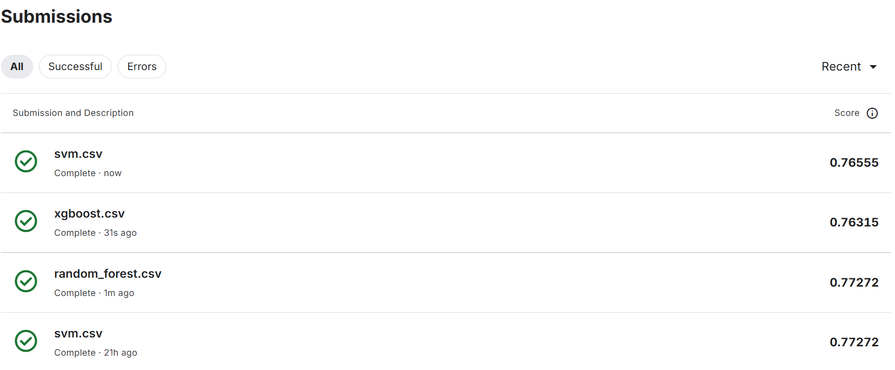

# Titanic — Previsão de Sobrevivência (Duelo de Modelos)

Projeto desenvolvido no curso **Profissão: Cientista de Dados (EBAC)**, Módulo 41 — *Duelo de Modelos 4*. O desafio: construir um pipeline completo de classificação para a competição [Titanic – Machine Learning from Disaster](https://www.kaggle.com/competitions/titanic) do Kaggle, comparando três algoritmos otimizados com busca de hiperparâmetros e validação cruzada, e submeter as previsões na plataforma.

**Melhor resultado: 0,77272 de acurácia no Kaggle** (Random Forest e SVM).

---

## 1. O problema

Em 15 de abril de 1912, o Titanic afundou após colidir com um iceberg; 1.502 dos 2.224 passageiros e tripulantes morreram. A competição pede um modelo que preveja, a partir de dados de cada passageiro (classe, sexo, idade, tarifa, porto de embarque…), se ele sobreviveu ou não.

É uma classificação binária clássica, e a competição é o ponto de entrada mais conhecido do Kaggle. A avaliação é feita pela própria plataforma, com acurácia sobre um conjunto de teste cujo gabarito não é divulgado.

## 2. Os dados

Fornecidos pelo Kaggle, em `data/`:

| Arquivo | Registros | Descrição |
|---|---|---|
| `train.csv` | 891 | Passageiros com a variável alvo `Survived` |
| `test.csv` | 418 | Passageiros sem o alvo — base da submissão |
| `gender_submission.csv` | 418 | Exemplo de submissão fornecido pelo Kaggle |

Variáveis usadas: `Pclass`, `Sex`, `Age`, `SibSp`, `Parch`, `Fare`, `Embarked`. As colunas `Name`, `Cabin` e `Ticket` foram descartadas.

## 3. Pipeline

```
Carga → Limpeza → Codificação → Seleção de features → Padronização → Busca de hiperparâmetros (5-fold CV) → Submissão
```

| Etapa | O que foi feito |
|---|---|
| Limpeza | Remoção de `Name`, `Cabin` (77 % nulos) e `Ticket`; imputação de `Age` e `Fare` pela média; exclusão das 2 linhas sem `Embarked` |
| Codificação | `Sex` com Label Encoding; `Embarked` com One-Hot Encoding |
| Seleção de features | Matriz de correlação → `Pclass`, `Parch`, `Sex`, `Fare`, `Embarked_S`, `Embarked_C` |
| Padronização | `StandardScaler`, ajustado no treino e aplicado ao teste |
| Modelos | Random Forest, XGBoost e SVM, cada um com `GridSearchCV` (cv = 5) |

Notebook completo: [`notebooks/titanic_duelo_de_modelos.ipynb`](notebooks/titanic_duelo_de_modelos.ipynb). A documentação com a justificativa de cada decisão está em [`docs/documentacao_tecnica.md`](docs/documentacao_tecnica.md).

## 4. Resultados

Pontuação de cada submissão no Kaggle (acurácia no *public leaderboard*):

| Modelo | Melhores hiperparâmetros encontrados | Score Kaggle |
|---|---|---|
| **Random Forest** | `n_estimators=100`, `max_depth=10`, `min_samples_split=5`, `criterion='gini'` | **0,77272** |
| **SVM** (1ª submissão) | `kernel='poly'`, `degree=3`, `C=1` | **0,77272** |
| SVM (2ª submissão) | `kernel='poly'`, `degree=4`, `C=1` | 0,76555 |
| XGBoost | `n_estimators=500`, `learning_rate=0.01`, `subsample=0.6`, `max_depth=None` | 0,76315 |

<p align="center">
  
</p>

Os três modelos ficaram próximos, com Random Forest e SVM empatados no melhor resultado. O arquivo `gender_submission.csv` do Kaggle — que prevê sobrevivência só pelo sexo — marca 0,76555, então o ganho dos modelos sobre esse *baseline* foi de 0,7 ponto percentual. A seção de conclusões da documentação técnica discute por que o ganho foi modesto e o que fazer para subir no ranking.

## 5. Estrutura do repositório

```
titanic-survival-prediction/
├── README.md
├── requirements.txt
├── data/                         ← train.csv, test.csv e gender_submission.csv (Kaggle)
├── notebooks/
│   └── titanic_duelo_de_modelos.ipynb
├── submissions/                  ← arquivos enviados ao Kaggle
│   ├── random_forest.csv
│   ├── xgboost.csv
│   └── svm.csv
├── docs/
│   └── documentacao_tecnica.md
└── images/
```

## 6. Como executar

```bash
git clone https://github.com/JMateus1997/titanic-survival-prediction.git
cd titanic-survival-prediction
pip install -r requirements.txt
jupyter notebook notebooks/titanic_duelo_de_modelos.ipynb
```

O notebook regenera os três arquivos de `submissions/`. A busca de hiperparâmetros do XGBoost (108 combinações × 5 folds) é a etapa mais demorada, e seu resultado pode variar ligeiramente entre versões da biblioteca; os arquivos em `submissions/` são exatamente os que foram enviados ao Kaggle.

## 7. Tecnologias

Python · pandas · NumPy · scikit-learn · XGBoost · imbalanced-learn · Matplotlib · Seaborn

## 8. Autor

**João Mateus Almeida** — Projeto desenvolvido no curso Profissão: Cientista de Dados, EBAC.
