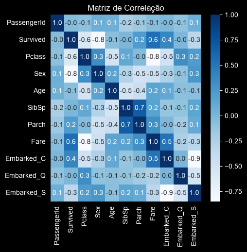

# Documentação Técnica — Titanic: Previsão de Sobrevivência

Curso Profissão: Cientista de Dados (EBAC) · Módulo 41 — Duelo de Modelos 4
Autor: João Mateus Almeida

---

## Sumário

1. [Contexto e objetivo](#1-contexto-e-objetivo)
2. [Coleta de dados](#2-coleta-de-dados)
3. [Limpeza e tratamento](#3-limpeza-e-tratamento)
4. [Codificação e seleção de features](#4-codificação-e-seleção-de-features)
5. [Padronização](#5-padronização)
6. [Modelagem e otimização de hiperparâmetros](#6-modelagem-e-otimização-de-hiperparâmetros)
7. [Resultados no Kaggle](#7-resultados-no-kaggle)
8. [Conclusões](#8-conclusões)
9. [Limitações e próximos passos](#9-limitações-e-próximos-passos)

---

## 1. Contexto e objetivo

A atividade do Módulo 41 propôs um "duelo de modelos": escolher algoritmos vistos ao longo do curso, aplicar as técnicas de aperfeiçoamento aprendidas (busca de hiperparâmetros, validação cruzada, balanceamento e padronização) e competir na plataforma Kaggle com a base do Titanic. A métrica final é o score reportado pelo Kaggle — acurácia sobre um conjunto de teste cujo gabarito não é público.

**Objetivo:** prever a variável binária `Survived` (1 = sobreviveu, 0 = não sobreviveu) para os 418 passageiros do conjunto de teste.

Três modelos foram treinados e submetidos separadamente: **Random Forest**, **XGBoost** e **SVM**.

---

## 2. Coleta de dados

Base pública da competição [Titanic – Machine Learning from Disaster](https://www.kaggle.com/competitions/titanic).

| Coluna | Descrição | Nulos no treino |
|---|---|---|
| `PassengerId` | Identificador | 0 |
| `Survived` | **Alvo** (0 / 1) | 0 |
| `Pclass` | Classe da passagem (1ª, 2ª, 3ª) | 0 |
| `Name` | Nome | 0 |
| `Sex` | Sexo | 0 |
| `Age` | Idade | 177 (19,9 %) |
| `SibSp` | Irmãos / cônjuges a bordo | 0 |
| `Parch` | Pais / filhos a bordo | 0 |
| `Ticket` | Número do bilhete | 0 |
| `Fare` | Tarifa paga | 0 |
| `Cabin` | Cabine | 687 (77,1 %) |
| `Embarked` | Porto de embarque (C, Q, S) | 2 |

Treino: 891 registros. Teste: 418 registros (1 valor nulo em `Fare`, 86 em `Age`).

---

## 3. Limpeza e tratamento

Notebook: Passo 1.

### 3.1 Colunas removidas

`Name`, `Cabin` e `Ticket` foram descartadas.

**Justificativa:** `Cabin` tem 77 % de valores ausentes, o que inviabiliza imputação confiável. `Name` e `Ticket` são identificadores textuais de alta cardinalidade, sem valor preditivo direto para os modelos escolhidos (extrair o título do nome — *Mr*, *Mrs*, *Miss* — é uma técnica conhecida nesta competição, mas ficou fora do escopo desta entrega; ver próximos passos).

### 3.2 Valores faltantes

| Coluna | Tratamento | Justificativa |
|---|---|---|
| `Age` (treino e teste) | Imputação pela **média** | Perder 20 % dos registros reduziria demais a base; a média é um valor neutro que não desloca a distribuição |
| `Fare` (1 nulo no teste) | Imputação pela média | Registro único; o teste não pode perder linhas, pois a submissão exige os 418 passageiros |
| `Embarked` (2 nulos no treino) | **Exclusão** das linhas | Apenas 0,2 % da base; imputar uma categoria seria inventar informação |

Resultado: treino com 889 registros e nenhum valor nulo; teste com 418.

---

## 4. Codificação e seleção de features

Notebook: Passo 2.

### 4.1 Codificação

| Variável | Técnica | Justificativa |
|---|---|---|
| `Sex` | Label Encoding (female = 0, male = 1) | Binária; um inteiro basta |
| `Embarked` | One-Hot Encoding → `Embarked_C`, `Embarked_Q`, `Embarked_S` | Três categorias sem ordem natural |

### 4.2 Matriz de correlação



A matriz guiou a seleção de variáveis. As correlações mais fortes com `Survived` são `Sex` (negativa: homens sobreviveram menos), `Pclass` (negativa: classes mais baixas sobreviveram menos) e `Fare` (positiva).

### 4.3 Features selecionadas

```python
variaveis = ['Pclass', 'Parch', 'Sex', 'Fare', 'Embarked_S', 'Embarked_C']
```

**Justificativa:** foram mantidas as variáveis com correlação mais relevante com o alvo. `Age` e `SibSp` apresentaram correlação fraca e ficaram de fora; `Embarked_Q` foi omitida porque, com `Embarked_S` e `Embarked_C` presentes, ela é redundante (se as duas são 0, o porto é Q). `PassengerId` é apenas identificador.

---

## 5. Padronização

`StandardScaler` ajustado **apenas no treino** (`fit_transform`) e aplicado ao teste (`transform`).

**Justificativa:** o SVM é sensível à escala das variáveis — `Fare` varia de 0 a 512 enquanto `Sex` é 0 ou 1, e sem padronização a tarifa dominaria o cálculo das distâncias. Ajustar o scaler só no treino evita vazamento de informação do teste. Random Forest e XGBoost não precisam de padronização, mas foram treinados nos dados padronizados para manter um único pipeline.

**Balanceamento:** a classe `Survived` tem 38 % de positivos e 62 % de negativos — um desbalanceamento leve. O SMOTE foi importado, mas optou-se por não aplicá-lo, porque a diferença entre classes é pequena e exemplos sintéticos poderiam distorcer uma base de apenas 889 registros.

---

## 6. Modelagem e otimização de hiperparâmetros

Notebook: Passo 3. Todos os modelos usaram `GridSearchCV` com **validação cruzada de 5 folds** — cada combinação de hiperparâmetros é avaliada cinco vezes, em partições diferentes do treino, e a média decide a melhor. Isso reduz o risco de escolher parâmetros que só funcionam em uma divisão específica dos dados.

### 6.1 Random Forest

| Hiperparâmetro | Valores testados | Melhor |
|---|---|---|
| `n_estimators` | 100, 200, 500 | **100** |
| `max_depth` | None, 10, 20, 40 | **10** |
| `min_samples_split` | 2, 5, 10 | **5** |
| `criterion` | gini | gini |

36 combinações × 5 folds = 180 treinos. Métrica da busca: acurácia.

**Por que Random Forest:** conjunto de árvores de decisão treinadas em amostras diferentes dos dados e com subconjuntos aleatórios de features. Reduz a variância de uma árvore única e costuma ser o modelo mais robusto "sem ajuste fino". A profundidade máxima 10 e o mínimo de 5 amostras por divisão escolhidos pela busca limitam o sobreajuste.

### 6.2 XGBoost

| Hiperparâmetro | Valores testados | Melhor |
|---|---|---|
| `n_estimators` | 100, 200, 500 | **500** |
| `max_depth` | None, 10, 20, 40 | **None** |
| `subsample` | 0.6, 0.8, 1.0 | **0.6** |
| `learning_rate` | 0.01, 0.05, 0.1 | **0.01** |

108 combinações × 5 folds = 540 treinos. Métrica da busca: **ROC AUC**.

**Por que XGBoost:** *gradient boosting* — cada nova árvore corrige os erros das anteriores. É o algoritmo mais usado em competições tabulares. A busca escolheu a combinação mais conservadora (taxa de aprendizado baixa, muitas árvores, 60 % de amostragem por árvore), que é a configuração típica para evitar sobreajuste em bases pequenas.

A métrica ROC AUC foi usada aqui (em vez de acurácia) para testar se otimizar a separação das classes, e não só a taxa de acerto, levaria a um resultado melhor no Kaggle.

### 6.3 SVM

| Hiperparâmetro | Valores testados | Melhor |
|---|---|---|
| `kernel` | linear, poly | **poly** |
| `degree` | 2, 3, 4 | **4** |
| `C` | 0.01, 0.1, 1 | **1** |

18 combinações × 5 folds = 90 treinos. Métrica da busca: acurácia.

**Por que SVM:** encontra o hiperplano que maximiza a margem entre as classes; com kernel polinomial, consegue fronteiras não lineares. É o modelo que mais depende da padronização, feita na etapa anterior.

Uma primeira versão da busca (com `RandomizedSearchCV`, `degree` em [2, 3] e `C = 1`) havia escolhido `degree = 3`; foi essa submissão que obteve 0,77272. A segunda versão, com o espaço de busca ampliado, escolheu `degree = 4` e obteve 0,76555 — um exemplo de que o melhor resultado na validação cruzada nem sempre é o melhor no teste.

---

## 7. Resultados no Kaggle


| Submissão | Score (acurácia) |
|---|---|
| `random_forest.csv` | **0,77272** |
| `svm.csv` (1ª versão, `degree=3`) | **0,77272** |
| `svm.csv` (2ª versão, `degree=4`) | 0,76555 |
| `xgboost.csv` | 0,76315 |

Referência: o `gender_submission.csv` fornecido pelo Kaggle, que prevê "sobreviveu" para toda mulher e "não sobreviveu" para todo homem, marca **0,76555**.

---

## 8. Conclusões

1. **Random Forest foi o modelo mais consistente**: melhor score, com a configuração mais simples (100 árvores, profundidade 10) e sem depender de padronização. É a escolha recomendada para este problema.

2. **Os três modelos convergiram para resultados muito próximos** (0,763 a 0,773). Quando algoritmos tão diferentes empatam, o gargalo não está no modelo, e sim nas *features*: todos estão extraindo a mesma informação dos mesmos seis atributos.

3. **O ganho sobre o baseline de sexo foi de 0,7 ponto percentual.** Isso mostra que `Sex` sozinho já explica a maior parte da sobrevivência, e que as demais variáveis selecionadas acrescentam pouco. É o resultado esperado para um pipeline sem engenharia de features nesta competição.

4. **Validação cruzada não garante o melhor resultado no teste.** O caso do SVM (`degree=3` superou `degree=4` no Kaggle, apesar de a busca ter preferido o segundo) é um lembrete de que, com 889 registros, a variância entre partições é grande.

---

## 9. Limitações e próximos passos

- **Engenharia de features** é o maior ganho possível. Os kernels mais bem pontuados desta competição extraem o **título** do nome (*Mr*, *Mrs*, *Miss*, *Master*), criam **tamanho da família** (`SibSp + Parch + 1`) e uma flag de **viaja sozinho**, e agrupam `Fare` e `Age` em faixas. Só o título costuma levar o score para a faixa de 0,78–0,80.

- **Imputação de `Age`** pela média global é a abordagem mais simples; imputar pela mediana por título ou por classe é mais fiel (crianças com título *Master* tinham idade mediana de 3,5 anos, muito longe da média geral de 29,7).

- **`Age` e `SibSp` foram descartadas** pela correlação linear fraca com o alvo, mas correlação de Pearson não captura relações não lineares — crianças pequenas tinham alta taxa de sobrevivência independentemente de outros fatores. Vale reincluí-las e deixar os modelos de árvore decidirem.

- **Ensemble**: combinar as previsões dos três modelos (votação) costuma dar um ganho pequeno, mas consistente, quando os modelos erram em passageiros diferentes.

- **Relatório de métricas no treino**: o notebook não registra acurácia, matriz de confusão ou `best_score_` da validação cruzada; incluir esses números permitiria comparar validação interna com o score do Kaggle e detectar sobreajuste.
